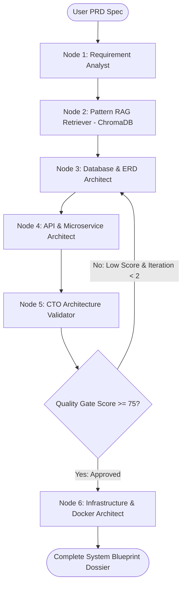

# 🏗️ Spec2Architecture — Autonomous System Design & Microservice Blueprint Generator

> **MCA (AI & Data Science) Major Capstone Project**  
> Built with **LangGraph**, **LangChain**, **ChromaDB Agentic RAG**, and **Ollama / Google Gemini Dual-Engine**.

---

## 📌 1. Project Overview & Abstract

In contemporary enterprise software engineering, translating a Product Requirement Document (PRD) into a resilient, scalable, distributed system architecture typically consumes weeks of senior architects' time. 

**Spec2Architecture** is an autonomous, multi-agent generative system design platform that transforms high-level product specs and user stories into:
1. **Normalized Database Schemas (PostgreSQL DDL)** with primary/foreign keys and high-cardinality indexes.
2. **Interactive Entity-Relationship Diagrams (Mermaid ERD)** with dynamic cardinality.
3. **Decoupled Microservice Boundaries** with complete **OpenAPI 3.0 (Swagger) specifications**.
4. **Interactive Architecture Flowcharts** showing client gateways, microservices, caches, and databases.
5. **A Chief Technology Officer (CTO) Audit Gate** that evaluates the architecture for Single Points of Failure (SPOF), security, and scalability bottlenecks using a **cyclical LangGraph loop**.
6. **Production Infrastructure Stacks** with ready-to-deploy `docker-compose.yml`.

---

## 🧠 2. Core Technical Architecture

### 🔄 The 6-Node LangGraph Cyclical State Machine:



---

## 🛠️ 3. Technology Stack & Frameworks

| Layer | Component | Functionality |
|---|---|---|
| **Orchestration** | **LangGraph** | Multi-agent cyclical state machine, conditional routing, state channel persistence |
| **Agent Tooling** | **LangChain Core** | Document loading, prompt templates, structured output parsing |
| **Local LLM** | **Ollama** | Local on-premise inference (`llama3:8b`, `mistral:7b`, `deepseek-r1:8b`) |
| **Cloud LLM Backup** | **Google Gemini 3.8 Flash** | Cloud API inference for low-compute environments |
| **Vector DB / RAG** | **ChromaDB** | Semantic vector storage of enterprise system design patterns |
| **Diagram Studio** | **Mermaid.js** | Live interactive vector rendering of ERDs and Microservice topology |
| **Frontend UI** | **Streamlit** | Interactive engineering dashboard with live node execution logs |
| **Infrastructure** | **Docker & Compose** | Containerized deployment blueprints for PostgreSQL, Redis, Kong Gateway |

---

## 📚 4. RAG Knowledge Base Patterns

The ChromaDB vector index stores curated enterprise architectural design patterns, including:
- **CQRS & Event Sourcing** (Command/Query Segregation with append-only logs)
- **Saga Pattern** (Choreographed vs Orchestrated distributed transaction rollback)
- **Cache-Aside & Multi-Level Redis Caching** (Handling Thundering Herd / Cache Stampede)
- **Database Sharding & Read Replicas** (Consistent hashing, replication lag mitigation)
- **Idempotency Keys & Token Bucket Rate Limiting** (Safe retries and DDoS protection)
- **Zero-Trust Microservice Security** (Mutual TLS, JWT Scopes, and Secret Management)

---

## 🚀 5. How to Run the Project

### Step 1: Install Dependencies
Open terminal or PowerShell in the project directory:
```bash
pip install -r requirements.txt
```

### Step 2: Run via 1-Click Batch File
Simply double click **`run.bat`** on your Desktop!

### Or Step 3: Run via Command Line
```bash
streamlit run app.py
```
Open **[http://localhost:8501](http://localhost:8501)** in your browser.

---

## 🎓 6. Academic Viva & Interview Presentation Points

When presenting to examiners or technical interviewers:
1. **Explain the Cyclical Graph:** *"Unlike traditional linear RAG chains, we implemented LangGraph's cyclic state machine where Node 5 audits the architecture and sends feedback back to Node 3 if the quality score is below threshold."*
2. **Highlight Privacy & Cost:** *"By leveraging local Ollama models, sensitive company product requirements never leave the local network, achieving zero API operational costs."*
3. **Showcase Grounded RAG:** *"Our ChromaDB retrieval ensures the model doesn't hallucinate arbitrary architectures; it grounds the design on proven distributed system patterns (CQRS, Saga, Idempotency)."*
